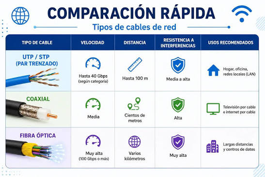
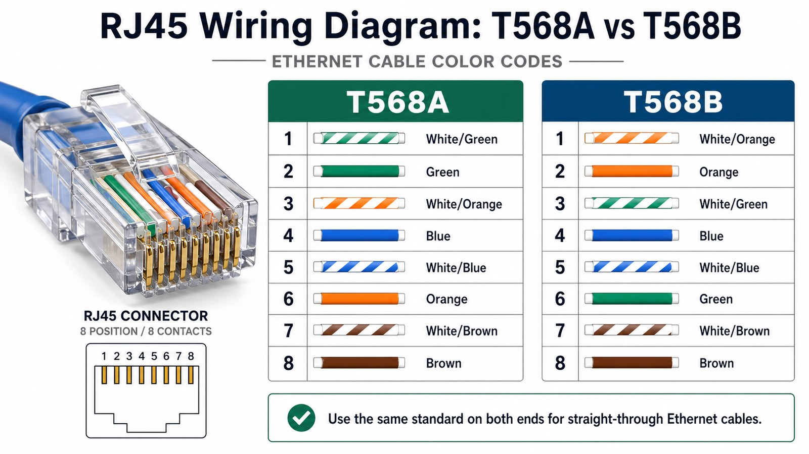
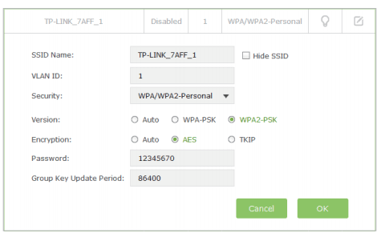

# ***DesenREDados***

## Configuración básica de red: guía para principiantes

> Una guía práctica y desenfadada para quitar dolores de cabeza.
> En este pequeño manual rápido vas a aprender a:
>
> * Conectar los dispositivos de tu hogar a la red (LAN)
> * Detectar pequeños errores que entorpecen tu conectividad en la red
> * Y a saber reconocer tus dispositivos en tu red doméstica.  

---

## Índice

- **[1. ¡Bienvenid@ a bordo!🫡](#1-bienvenid-a-bordo)**
  - [Introducción](#introducción)
- **[2. Tu kit de supervivencia](#2-tu-kit-de-supervivencia)**
  - [¿Qué necesito?](#qué-necesito)
  - [Recursos necesarios](#recursos-necesarios)
- **[3. El Arca de Noé](#3-el-arca-de-noé)**
  - [Conociendo a los integrantes](#conociendo-a-los-integrantes)
- **[4. Operación **LAN**gosta🦞](#4-operación-langosta)**
  - [Desplegando tu red](#desplegando-tu-red)
- **[5. ¡Hey camarada, Tierra a la vista!](#5-hey-camarada-tierra-a-la-vista)**
  - [¿En serio me está funcionando?](#en-serio-me-está-funcionando)
- **[6. Primeros Auxilios ante la tormenta](#6-primeros-auxilios-ante-la-tormenta)**
  - [FAQs](#faqs)
- **[7. El triángulo de las bermudas](#7-el-triángulo-de-las-bermudas)**
  - [Glosario](#glosario)
  - [Tu Piedra rosetta: Anexo](#tu-piedra-rosetta-anexo)
- **[8. Tu bitácora de confianza](#8-tu-bitácora-de-confianza)**
  - [Referencias](#referencias)

---

## 1. ¡Bienvenid@ a bordo!🫡

### Introducción

 ¡Muy buenas grumetill@! bienvenid@ a este pergamino internáutico!. En esta breve aventurilla entendrás los parámetros básicos de una red y sabrás cómo configurar las coordenadas para conectar tus dispositivos a la LAN.

¿Zarpamos? 🛥️.

---

## 2. Tu kit de supervivencia

### ¿Qué necesito?  

¡Leva anclas, mariner@! y para ello deberás comprobar que tienes todo lo que necesitas para poder montar tu pequeña red LAN en casa. Por ahora tranquil@ no temas, aquí te dejo este pequeño kit para evitar que naufragues.

#### Recursos necesarios

* *Router\/módem*.
* *Cableado del router* (fibra óptica o cable de cobre).
* *Conexión mediante Wi-Fi o cableado Ethernet*.
* *Configuración de red correcta*.
* *Ordenador con NIC*.
* *Navegador Web* (Chrome, Firefox, Opera, Safari..).
* *Credenciales para el acceso* a la interfaz de la puerta de enlace.
* *Consola de comandos* (opcional).

> Nota: Si tienes un router 4G/5G el único cable que necesitarás, será el que se conecta de tu router a la toma de corriente de casa.

---

## 3. El Arca de Noé

### Conociendo a los integrantes

Deberás conocer cada integrante de la tripulación, pues cada uno cumple una función importante para que la red LAN funcione de forma correcta.

Así que.. ¿a que esperas?, ¡sumérgete! 🥽

**El ROUTER:** tu gran capitán del barco.
Encargado de interconectar redes diferentes (entre ellas nuestra LAN con internet), Asigna direcciones IP mediante DHCP, determina la mejor ruta para enviar los datos, separa dominios broadcast, aplica reglas de seguridad y control de tráfico, también realiza la función de módem.

* *Función especial:* proporcionar punto de acceso Wi-Fi.

**El PC:** uno de tus mejores tripulantes.
Dispositivo\/nodo final que empleamos para enviar y recibir datos mediante la red, navegar por internet, comunicarse con el resto de equipos o router...
La NIC es la tarjeta de red física del PC. Te proporciona la interfaz (lógica) que permite la comunicación del PC con las redes.

**Cableado VS Wi-Fi:** tus velas del barco.
Para poder comunicarte deberás elegir el medio que usará tu ordenador para conectarse a la LAN.

* *Cable Ethernet RJ45:* La conexión de tu dispositivo a la red es mediante la conexión física de un cable de cobre de par trenzado. Se conectaría desde uno de los puertos del PC a uno de los puertos LAN del router.

* *Wi-Fi:* La conexión de tu dispositivo a la red es mediante el aire (ondas de radio).

> NOTA: Si buscas estabilidad o velocidad de transferencia Ethernet será tu mejor aliado, por el contrario si buscas tener más movilidad, el Wi-Fi será tu opción preferida.

**Navegador Web:** El que usarás para introducir la IP de la puerta de enlace (router) y así poder acceder a su interfaz.

**Credenciales de acceso de la puerta de enlace:** He aqu las llaves maestras del camarote del capitán.
Lo que viene siendo el usuario y contraseña que te permiten el acceso a la interfaz del router, para cambiar parámetros de su configuración. (a veces viene impreso en una de las etiquetas)

**Consola de comandos:** La terminal que emplearás para comprobar información de los dispositivos, diagnosticar pequeños fallos...etc

---

## 4. Operación **LAN**gosta🦞

### Desplegando tu red

Muy bien, grumetill@!. Ahora que has entendido los roles básicos de tu tripulación, ha llegado el momento de poner las manos en el timón, ya sabes.... un buen marinero no se convierte en capitán del barco sólo con leer cuatro pergaminos.
¡Venga,🎣 manos a la red!

1. **Conecta el Hardware:**
Enchufa el router a la toma de red (F.óptica\/cobre, según la instalación que tengas puesta en casa).Asegurate de que está encendido y sin ninguna luz ámbar o roja.




  - **Si la conexión es por cable Ethernet-RJ45:**
  Por defecto suele asignar los parámetros de conexión de forma automática. (IP mediante DHCP, máscara subred, DNS). Aquí debes entrar a la puerta de enlace para asegurarte de que todo esté correctamente asignado y si quieres, podrás modificar algún parámetro de configuración de la red.

  

  - **Si por el contrario es por Wi-Fi:**
  La forma más sencilla sería mediante la interfaz gráfica en tu PC (desde configuración>configuración de red e internet), seleccionas el SSID y contraseña de tu red, ambos impresos en las etiquetas del router. Normalmente los operadores entregan los routers ya preconfigurados (DHCP, internet, DNS..).

    - Abre el símbolo del sistema **(CMD)** y ejecuta el siguiente comando `ipconfig /all` y localiza la IP de la puerta de enlace. (cópiala)
   (también puede venir impresa en una parte de las etiquetas del router, en la documentación de la instalación, o hablando con tu ISP si te resulta más sencillo).
    - Abre el navegador e inserta la IP del gateway que has copiado y pulsa Enter. (te redigirá a la interfaz\/panel de administración del gateway\/router).
    - Introduce las credenciales de acceso de administración del router(en la etiqueta impresas, proporcionadas por el técnico o en la documentación de la instalación).
    - Comprueba que la asignación sea correcta: IPv4, máscara de subred, DHCP, DNS y Cifrado (WPA2 o 3). Revisa el SSID (nombre de la red), y contraseña. Estos 2 parámetros anteriores es recomendable que los modifiques.
  
      

    - Si están correctos los datos asignados , cierra el panel de administración del router.

2. **Comprueba la configuración en la consola:** (opcional, servirá para reconocer los parámetros asignados de todos tus dispositivos que estén en la LAN y para comprobar posteriormente sus parámetros después de realizar modificaciones).

 * **Abre CMD (terminal):** 
  Ejecuta comando `ipconfig /all` (WIN) o `ip addr` (Linux). Observa los parametros: IPv4, máscara subred, puerta de enlace, DNS, DHCP habilitado y su dirección.

---

## 5. ¡Hey camarada, Tierra a la vista!

### ¿En serio me está funcionando?

Si todo está configurado de forma correcta, será la hora de que lances la sonda al agua y compruebes tu conexión. Realizarás 2 pruebas:

1. ***Comprueba conexión del PC con el router.*** (conectividad con tu red privada)
2. ***Comprueba que tienes acceso a Internet.*** (conectividad con las redes externas)

* Abre **CMD** (Windows) y ejecuta:

```batch
route print
ping 192.168.1.1
ping 8.8.8.8
```

* O abre **Terminal** (Linux) y ejecuta:

```bash
ip route show
ping 192.168.1.1
ping 8.8.8.8
```


  Esto enviará *4 paquetes ICMP (mensajes) de prueba por cada solicitud ping (prueba de conectividad)*, mostrándote la conectividad con tu red y con internet, además te mostrará la tabla de enrutamiento, que te especifica la *ruta Default*.
 
  La **ruta Default** es la puerta de enlace a la que se envía  el tráfico cuando el destino *NO es ninguna de las rutas que están dentro de tu red*. Esa ruta normalmente suele ser **0.0.0.0**, que significa "si no vas a ninguna de las direcciones de la red interna ve a la Por defecto", que suele ser **Internet**. 

Si la respuesta del ping es correcta y la tabla de enrutamiento también, ¡Enhorabuena tripulante!, has conseguido seguir las todas las coordenadas, has guiado a la tripulación y has navegado con tu barquito hasta llegar con éxito al puerto.

  > OJO: Deberás introducir la dirección de tu  puerta de enlace 192.168.x.x que tengas asignada.

---

## 6. Primeros Auxilios ante la tormenta

### FAQs

Grumete, todo a babor tormenta a la vista! Pero tranquil@, no te tires por la borda y échale un vistazo al kit de emergencias que seguro te salvará de muchas.

- ***Me pone "Conectado" pero no tengo internet. SOS ¿Qué hago?***

  - *Comprueba HW:* puertos, conectores, cables y luz del router.
  - *Reinicia el router.*
  - Mira DHCP activo, tu IP, puerta de enlace y  máscara asignada correctamente en tu PC, de no serlo meterla manualmente.
  - Haz *ping* a tu gateway y a tu ip pública para ver donde corta la conexión.

- ***¿Hola, alguien sabe por qué la red va tan lenta, ¿que puedo hacer?***
  - Mira si solo a un nodo, si es a todos podría ser problema por parte del operador o del router.
  - Si te conectas por Wi-fi, mira el alcande de la señal. Evita obstáculos.
  - Haz test de velocidad y contrástalo con la que contrataste.
  - Comprueba que no tengas algún piratatilla no autorizado robando ancho de banda. `arp -a` (WIN), `ip neigh` (Linux). De la lista que muestra..¿Todos son dispositivos conocidos?.
  De no conocer alguno, refuerza las medidas de seguridad. (ACL, contraseñas, firewall).

- ***Internet me dice que el servidor DNS no responde. No sé que hacer, ¡Ayuda!***

  - Haz ping a tu IP privada y la pública.
  - Si la pública responde puede ser un problema de traducción de nombres de dominio.
  Comprueba la resolución DNS en terminal, por ejemplo escribe `ping https://www.google.com`, si recibes algún error, prueba a configurar *DNS manualmente.* También puedes realizar consultas para obtener información de DNS con los comandos: `nslookup [dominio]` y `dig [dominio]` para Windows y Linux respectivamente.

---

## 7. El triángulo de las bermudas 🗾

¿Recuerdas la leyenda?...5 bombarderos desaparecieron tras registrarse reportes de fallas en las brújulas.. el hidroavión enviado al rescate, también se perdió, así que...
¡No tientes tu suerte!. Por aquí te dejo una pequeña brújula de emergencia.🧭

### Glosario

* **IP:** Es un identificador numérico que permite que los dispositivos en una red se comuniquen entre sí. Cada dispositivo conectado a Internet o a una red local tiene una dirección IP única (IPv4 o IPv6).

* **LAN:**  Conecta un conjunto de dispositivos dentro de un área geográfica limitada, como una habitación, edificio o conjunto de edificios. Este tipo de redes se utilizan para interconectar ordenadores personales y estaciones de trabajo en empresas, oficinas o aulas.
  
* **DHCP:** *"Dynamic Host Configuration Protocol"* Asigna direcciones IP auntomáticamente. (Función del router).
  
* **DNS:** *"Domain Name System"*: Traduce nombres de dominio en direcciones IP. (Función de los servidores externos).

* **Puerta de enlace\/gateway:** Es el dispositivo en una red local que permite a los dispositivos de esa red comunicarse con otros dispositivos en redes externas, como Internet. Normalmente es un router o un switch.

* **Máscara de subred:** Se usa en redes IP para *dividir la dirección IP en dos partes*: la parte que identifica la **red** y la que identifica a los dispositivos dentro de esa red **(hosts)**. Ejemplo: 255.255.255.0

* **Ancho de banda:** Se usa para determinar la velocidad de transmisión. Es decir, la cantidad de datos que puede transmitirse por segundo a través de una conexión o medio de
transmisión.


### Tu Piedra rosetta: Anexo

 |  Windows        |  Linux     |            Uso                        |
 |   :---          |  :---:     |            ---:                       |
 |  ipconfig /all  |  ip addr   |   Ver detalles configuración red (IPs)|
 |  ping [IP]      |  ping [IP] |   Comprobar conexión                  |
 |  tracer [IP]    |  ip route  |   Trazar ruta                         |
 |  netstat -a     |  ss        |   Conexiones/puertos                  |
 |  nslookup       |  dig       |   Consultas DNS                       |

[Configuración en Packet tracer](https://www.youtube.com/shorts/qASjkTVBVPk)

---

## 8. Tu bitácora de confianza 

Como buen patrón\/a llevarás tu diario de abordo, pero también necesitarás un buen mapa del tesoro.
Tranquil@ no te desesperes, por aquí te dejo el mío 🗺️ ¡No pierdas el rumbo!.

### Referencias

- ***Apuntes/ejercicios - Redes SMR 2025\/26***

- ***[Configuración LAN IPv4 - Cisco](https://www.cisco.com/c/es_mx/support/docs/smb/routers/cisco-rv-series-small-business-routers/smb5437-configure-ipv4-lan-connections-on-rv132w-or-rv134w.html)***
  
- ***[Configuración de red doméstica - RedesZone](https://www.redeszone.net/tutoriales/redes-cable/configurar-red-domestica-desde-cero/)***

- ***[Imágenes de referencia](https://www.google.com/search?tbnid=bsaKagDbbV-IKM&tbnh=0&tbnw=0&sca_esv=e7222caca06c9bd0&cs=0&sxsrf=APpeQnt20FxtTw2iJDcZWzCZc-Jo4dhvEw:1791806292979&udm=2&tbs=rimg:CW7GimoA221fYY38lm8gU6lo4AIA&q=imagenes+configuracion++basica+de+red&sa=X&ved=2ahUKEwjFxuPMtrSXAxWLXqQEHX5qIdEQuIIBegQIOBAA&biw=2048&bih=926&dpr=0.94)***

- ***[Cables, Ethernet y fibra](https://www.data-alliance.net/es/cables-ethernet-y-fibra?srsltid=AU7gw4XtlIDxLqzZP8-EBTl-DRAhSXwWtiNrkhNtRjzlghNN2lfDR72M)***